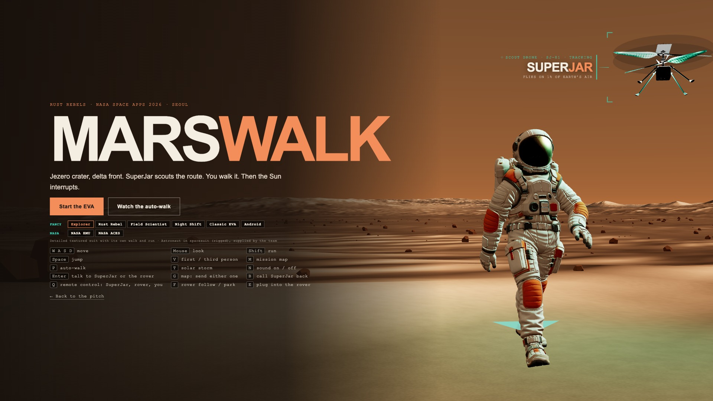
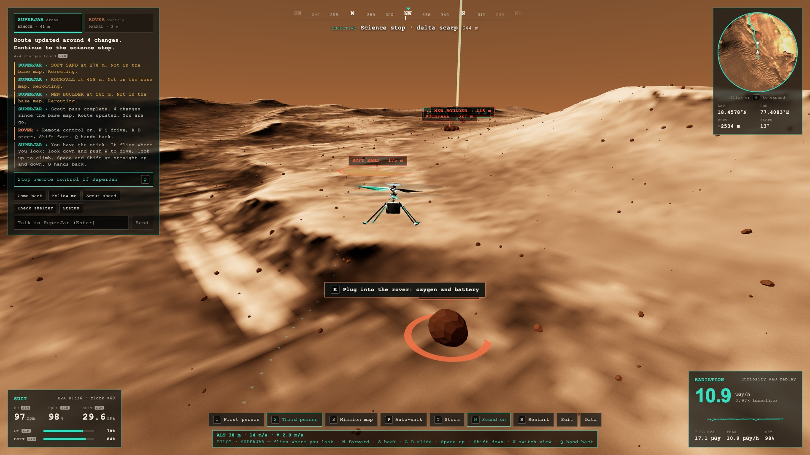
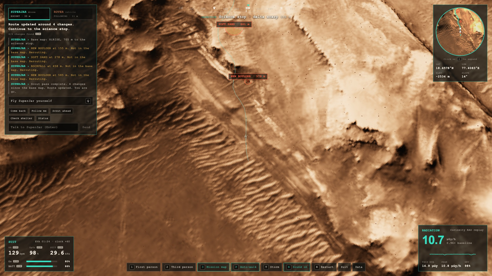
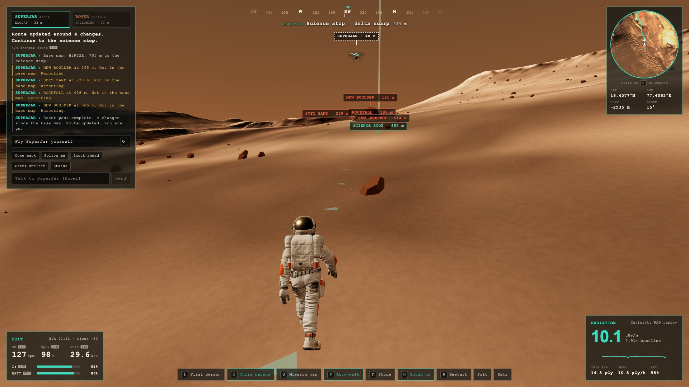
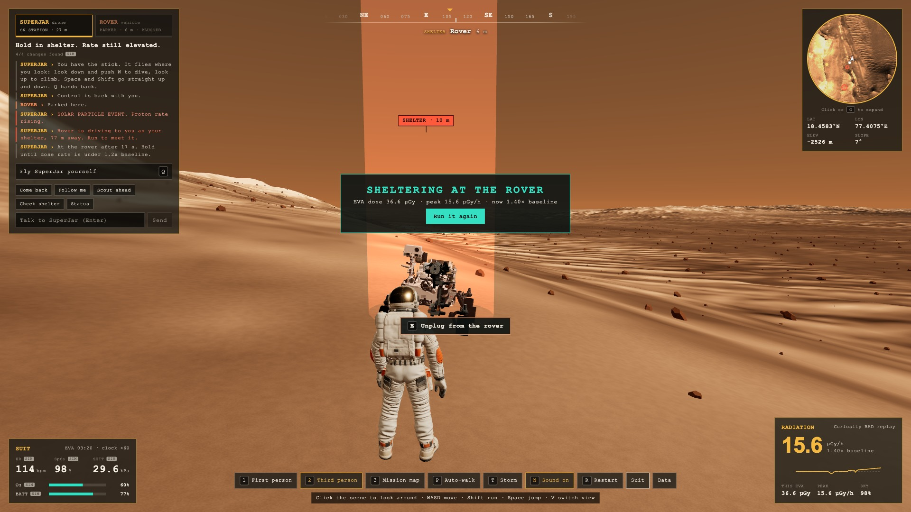

# Rust Rebels · Marswalk

**A scout-first, radiation-aware map for walking on Mars, playable in your browser on real NASA terrain.**

NASA Space Apps Challenge 2026 · Seoul · Challenge: [Interplanetary Survival Guide: Martian Map](https://www.spaceappschallenge.org/2026/challenges/interplanetary-survival-guide-martian-map/)

| | |
| --- | --- |
| ▶ **Play it** | **https://rust-rebels-mars.vercel.app/app** (desktop browser, no install) |
| Pitch site and slide deck | https://rust-rebels-mars.vercel.app |
| Team page | [Rust Rebels on spaceappschallenge.org](https://www.spaceappschallenge.org/2026/find-a-team/arc-playground/) |

[](https://rust-rebels-mars.vercel.app/app)

## For judges: where to look

| If you have | Do this |
| --- | --- |
| 30 seconds | Open the [30-second demo](https://rust-rebels-mars.vercel.app/demo) and press play. |
| 5 minutes | Press **Start the EVA**. Walk with `W A S D`, let SuperJar scout, then press `T` to trigger the solar storm and run for the rover. |
| 10 minutes | Read the [pitch deck](docs/RustRebels_SuperJar_Marswalk.pdf) (7 slides) and press the **Data** button in the app: it lists what is real, derived and simulated. |
| Time for detail | Follow the [repository map](#repository-map) below. |

## The problem

An astronaut on Mars walks through a radiation field with an old map.

- **Radiation.** Curiosity's RAD instrument measured 0.67 mSv a day on the surface, about 100 times Earth's natural background. A solar particle event can raise the dose rate several-fold within hours.
- **Stale maps.** Orbital maps are months old. Boulders fall, sand moves, and soft ground traps vehicles: Spirit got stuck in 2009.
- **No time to think.** When a solar storm arrives, the astronaut needs one answer fast: where is shelter, and how do I get there?

## Our answer: scout first, then walk

**SuperJar**, a scout helicopter, flies the planned route before the astronaut steps out. What it finds updates a digital twin of the site built from NASA orbital data, and the route is re-planned around every change. During the walk the astronaut sees one display: heading, route, dose rate, suit and the nearest shelter. When a storm hits, the display turns red and leads them to shelter.

| | |
| --- | --- |
|  **1. Scout.** SuperJar flies the route and flags what the base map does not show. |  **2. Re-plan.** On the mission map the route bends around new hazards and any slope over 25°. |
|  **3. Walk.** Real terrain, Mars walking pace, live dose rate. |  **4. Survive.** A real 2017 solar storm is replayed; the rover drives in as shelter. |

## What you can do in the demo

- Walk the Jezero delta front in first or third person, at the walking pace measured for Mars gravity.
- Send SuperJar to scout, or fly it yourself. Order it in plain words or by clicking the map.
- Call the rover, drive it by remote control, and plug in to recharge your suit.
- Watch the dose rate, replayed from Curiosity's radiation record, and outrun the September 2017 solar storm.
- Choose a suit, including NASA's own EMU and ACES suit models.

Controls are listed in the [app README](rust-rebels/README.md#marswalk-game-app).

## NASA data we used

Everything below is loaded by the demo unless marked. Scripts, checks and limits are in the [dataset README](rust-rebels/dataset/README.md).

| Data | Mission or source | How we use it |
| --- | --- | --- |
| HiRISE elevation mosaic, 1 m per pixel, and orthomosaic, 25 cm per pixel (Mars 2020 Terrain Relative Navigation) | Mars Reconnaissance Orbiter, via USGS | The ground itself, plus the slope, route and shelter maps we derive from it |
| CTX mosaics, 6 m image and 20 m elevation | Mars Reconnaissance Orbiter | Minimap and the 20 km of surroundings |
| 260 rover waypoints and 45 helicopter landing spots | Perseverance and Ingenuity | Start point, science stop and scale check |
| RAD dose rate, 787 readings, 7–14 Sep 2017 | Curiosity, via PDS | Quiet-day dose rate and the solar storm |
| DONKI space-weather records, Sep 2017 | NASA CCMC | The storm alert |
| MEDA weather, one sol | Perseverance, via PDS | Prepared in the dataset; not shown in the demo yet |
| SuperCam microphone recordings | Perseverance | Wind, helicopter and laser sounds |
| 3D models of Perseverance, Ingenuity and the EMU and ACES suits | NASA | The rover, SuperJar and two wearable suits |

**One check we are proud of:** our terrain matches the elevation Perseverance itself recorded at 260 waypoints to within 0.39 m, and 0.02 m in the median.

## What is real, and what is not

We would rather be clear than impressive.

| Real NASA data | Derived by us | Simulated |
| --- | --- | --- |
| Terrain shape and surface image | Slope map, walkable route, sky-view and shelter spots | New boulders, sand and rockfall, and SuperJar detecting them |
| Dose-rate record and the 2017 storm | Dose shown = RAD reading × fraction of sky visible (a geometric estimate, not a dose calculation) | SuperJar's lidar scan in the demo film |
| Rover waypoints, models and sounds | Walking speed from published Mars-gravity research | Vitals, oxygen and battery |

Limits worth knowing:

- RAD measured Gale crater, not Jezero. No radiation instrument has flown at Jezero.
- The chat with SuperJar and the rover is rule-based. There is no language model behind it.
- The rover is shown as the storm shelter, but the demo applies no dose reduction there, because we have no figure for it.
- The mission clock and the storm run faster than real time.

## Built in the demo, and proposed in the pitch

The pitch deck describes the full system. The demo builds the part that can be shown in a browser.

| Part of the idea | In the demo | In the pitch only |
| --- | --- | --- |
| Digital twin of the site | HiRISE and CTX terrain, slope, route and shelter solver | MOLA, CRISM and RIMFAX layers |
| SuperJar scouting | Scout pass, hazard flags, re-planned route, plain-word orders | The 8-instrument payload and on-board hazard detection |
| Radiation awareness | Dose rate from RAD, storm from RAD and DONKI | Timepix3 particle tracking and a 3D dose map |
| Storm protocol | Alert, red route, rover drives to meet you | Water vest and X-ray backup link |

## Run it yourself

Needs Node.js 24 and pnpm. No environment variables or API keys.

```sh
git clone https://github.com/prof-lijar/rustrebels-nasaspaceapps2026-seoul.git
cd rustrebels-nasaspaceapps2026-seoul/rust-rebels
pnpm install
pnpm dev
```

Open http://localhost:3000 for the pitch site and http://localhost:3000/app for the demo.

Built with Next.js, TypeScript and three.js. No game engine and no plugin. Data preparation is Python (rasterio, NumPy, SciPy, Pillow).

## Repository map

| Path | What is there |
| --- | --- |
| [`rust-rebels/`](rust-rebels/) | The web app: pitch site and the Marswalk demo. Its [README](rust-rebels/README.md) has commands, layout and controls. |
| [`rust-rebels/src/features/game/`](rust-rebels/src/features/game/) | The demo: 3D engine, terrain and route solver, display, suits and the 30-second film. |
| [`rust-rebels/dataset/`](rust-rebels/dataset/) | Scripts that download NASA data and build the files the browser loads, with sources, credits, checks and limits. |
| [`rust-rebels/public/dataset/`](rust-rebels/public/dataset/) | The browser-ready data: terrain, radiation, space weather, models, audio. |
| [`docs/RustRebels_SuperJar_Marswalk.pdf`](docs/RustRebels_SuperJar_Marswalk.pdf) | Pitch deck, 7 slides. |
| [`docs/how-we-built-the-3d-mars-world.md`](docs/how-we-built-the-3d-mars-world.md) | How NASA elevation data becomes the 3D world. |
| [`docs/PRD-martian-map-app.md`](docs/PRD-martian-map-app.md) | Product requirements for the app, and the [implementation plan](docs/implementation-plan.md). |
| [`docs/rust-rebels-team-identity.md`](docs/rust-rebels-team-identity.md) | Team name, introduction and image. |

## Team

**Rust Rebels**, Seoul. *Serious curiosity. Bold experiments. Red dust on everything.*

| Member | Role |
| --- | --- |
| Li Jar | Engineer, KAIST OverEdge |
| Dr. Amar | Radiation and X-ray physics, KAIST |
| SuperJar | AI scout drone |

## Use of AI

- The team image and poster are AI-generated fictional concept art. The figures are not the team.
- AI coding assistants helped write the code and documentation.
- The demo itself contains no AI model: SuperJar's replies are rule-based.

## Credits

NASA data and media are used with credit and do not imply NASA endorsement. Full credits and source links are in the [dataset README](rust-rebels/dataset/README.md#sources).

- Terrain: NASA/JPL-Caltech/University of Arizona/MSSS/USGS
- Radiation: NASA/JPL-Caltech/SwRI · Space weather: NASA CCMC
- Rover, helicopter and suit models: NASA/JPL-Caltech and NASA
- Sound: NASA/JPL-Caltech/LANL/CNES/CNRS/ISAE-Supaero
- Game-art suits: Astronaut by Quaternius (CC0) and Rigged Astronaut by J-Toastie (CC BY 3.0)
