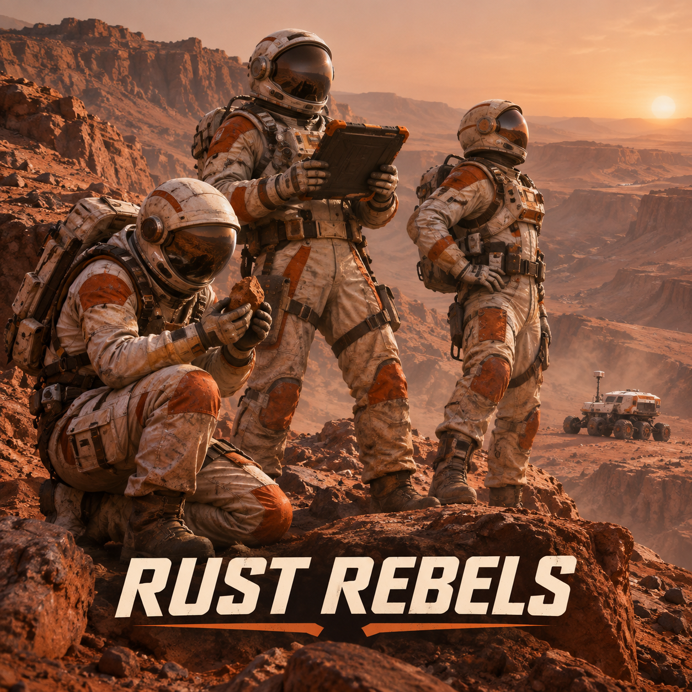

# Rust Rebels

Created: 2026-11-03

## Identity

**Rust Rebels** is short, alliterative, and tied to the rusty terrain of Mars. It combines scientific curiosity with playful, independent inventor energy. This is a creative name recommendation, not a claim of worldwide name or trademark exclusivity.

**Line:** Serious curiosity. Bold experiments. Red dust on everything.

**Challenge:** Interplanetary Survival Guide: Martian Map.

**Published team:** [Rust Rebels](https://www.spaceappschallenge.org/2026/find-a-team/arc-playground/), Seoul. Name, challenge, introduction, image, and recruiting interests verified on the published page on 2026-11-03. The original URL remains in use. [Verification screenshot](assets/rust-rebels-published.jpg).

## Team introduction

Big ideas. Real science. A little mischief. We're Rust Rebels, bringing garage-inventor energy to Mars exploration. Our aim: turn NASA terrain, imagery, and geological data into an intuitive tool for planning science-rich Marswalks, comparing routes, and making uncertainty visible. We're looking for curious builders in coding, planetary science, geospatial analysis, data visualization, and design. Serious curiosity. Bold experiments. Red dust on everything.

## Team image



Generated with the built-in image generation tool. Photorealistic fictional expedition concept art; the figures do not depict actual team members. Saved original: `docs/assets/rust-rebels-team.png` (1254 × 1254 PNG).

## Generation prompt

```text
Use case: photorealistic-natural
Asset type: square team profile image for a NASA Space Apps hackathon team called Rust Rebels.
Create a striking photorealistic cinematic concept image of a fictional Mars science expedition, with three anonymous fully helmeted explorers in practical off-white pressure suits with burnt orange accents, standing together on a rugged rusty Martian ridge. One holds a rugged terrain mapping tablet, one kneels to inspect a rock sample, one looks toward the route ahead. Their body language conveys bold curiosity, camaraderie and garage-inventor confidence. In the distance: layered canyon walls and a small plausible six-wheel science rover. Natural dusty atmosphere, low warm sunlight, tactile scuffed metal, fabric seams, fine red dust, believable geology. Film-still quality with restrained color grading, no excessive sci-fi glow or holograms.
Composition: square, strong centered group silhouette that remains readable as a small avatar. Keep all critical subjects and the title within the central 75 percent so circular crops work. Include only the exact team name "RUST REBELS" in crisp, compact bold ivory lettering in the lower middle, expertly integrated like an expedition poster. No other text.
This is fictional concept art, not a documentary photograph or actual team portrait. No visible faces, no celebrity likenesses, no Marvel or Iron Man designs, no NASA logos, no weapons, no flag, no watermark. Avoid cartoon illustration, glossy toy suits and clutter.
```
